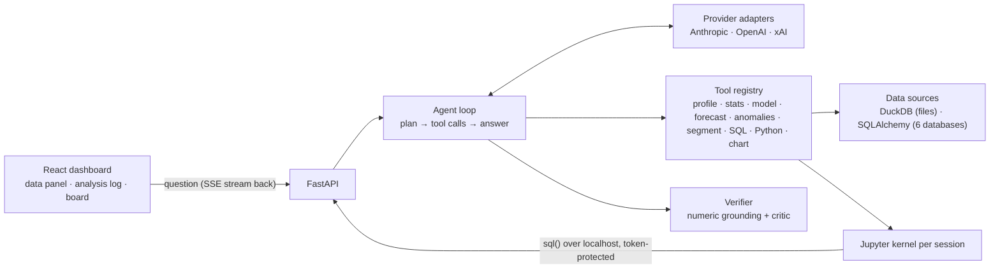

# AI Data Scientist

Ask questions about your data in plain English. An agent plans the analysis, runs SQL, Python, statistical tests
and machine-learning models, **checks every number in its answer against the results**, and shows each step's
code so you can verify it.

> Screenshot / demo GIF: `docs/screenshots/` (see [docs/demo-script.md](docs/demo-script.md) for recording one).

## What it does

- **Bring your data:** upload CSV or Excel files (each sheet becomes a table), or connect live databases:
  PostgreSQL, MySQL/MariaDB, SQLite, SQL Server, Snowflake and BigQuery. Several sources can be open at once, and
  questions can span them.
- **Choose your model:** the latest Claude Opus (default), Claude Sonnet, OpenAI GPT or xAI Grok. "Latest" is
  read from each provider's model list, so it stays current.
- **Bring your own access:** an API key for any provider, or **Sign in with ChatGPT** to use a Plus/Pro plan.
- **Data-science depth, not just charts:**

  | Tool | What it does | Built-in rigor |
  |---|---|---|
  | `profile_dataset` | Types, missing values, distributions, correlations | Flags ID columns, skew, outliers, duplicates, target leakage |
  | `statistical_test` | Group comparisons and associations | Picks t / Welch / Mann-Whitney / ANOVA / Kruskal / chi-square / Fisher / Pearson / Spearman from assumption checks; reports effect size, CI, Holm-corrected post-hoc tests |
  | `train_model` | Classification or regression | Baseline vs linear vs gradient boosting, 5-fold CV plus held-out test, leakage checks, permutation importance |
  | `forecast` | Time-series forecasting | Seasonality detection, ETS vs SARIMA chosen by rolling-origin backtest against a seasonal-naive baseline, 95% intervals |
  | `detect_anomalies` | Unusual days or rows | STL residual robust z-scores, or Isolation Forest with contributing features |
  | `segment` | Customer/record segments | k-means with k chosen by silhouette, profiles of what distinguishes each segment |
  | `run_sql`, `run_python`, `create_chart` | Anything else | Read-only SQL guard; a stateful Jupyter kernel |

- **Verified answers:** every number in an answer must appear in a tool result (at the precision shown), and a
  reviewer pass checks for causal over-reach, ignored assumptions and small samples. Problems trigger one revision;
  the answer is stamped *Verified* or *Needs review*.
- **Reproducible:** export the whole session as a runnable Jupyter notebook, or as a Markdown report with pinned
  insights.

## Quick start

Requires Docker.

```bash
docker compose up --build
```

Open http://127.0.0.1:8000, add a key (or sign in with ChatGPT) under **Settings**, then click **Load sample data**
and try a suggested question. A demo Postgres database with the same data runs alongside: connect to it from the
app with host `postgres`, port `5432`, database `retail`, user `analyst`, password `analyst` (read-only).

Keys can also go in a `.env` file (copy `.env.example`).

## How it works



- **Agent loop** (`backend/src/adsci/agent/orchestrator.py`): a hand-written tool-use loop over a
  provider-neutral message format, so the same conversation can continue on a different model. It streams
  `plan`, `step_start`, `step_output`, `answer`, `verification` and `usage` events to the UI. Steps are capped
  (12 by default), and tool errors go back to the model so it can fix its own SQL or code.
- **Provider adapters** (`backend/src/adsci/llm/`): Anthropic Messages API and the OpenAI-compatible Responses
  API (OpenAI and xAI). Claude's thinking blocks and OpenAI's encrypted reasoning items are replayed unchanged
  between turns, and history is append-only so reasoning stays valid.
- **Tools** (`backend/src/adsci/tools/`, `backend/src/adsci/analytics/`): each analysis is a plain, unit-tested
  Python function; the tool wrapper turns it into a compact summary for the model and rich tables and charts for
  the UI. The exported notebook calls the same functions, so it reproduces the agent's numbers exactly.
- **Safety:** SQL is parsed with sqlglot and must be a single `SELECT` on loaded tables (row-limited, statement
  timeout, read-only sessions where the database supports them; DuckDB file access is disabled). The Python
  kernel reaches data only through the backend's guarded `sql()` endpoint and gets an allowlisted environment.
  In Docker each running kernel gets its own OS user (from a pool of 16) that cannot read the app's data
  directory, where the encrypted
  credentials and their key live, and the app refuses API calls that come from inside the container, so
  analysis code can't change or delete stored credentials either, and sessions can't reach each other's kernels.
- **Use a read-only database account.** The SQL guard also blocks functions that run SQL on other servers or
  have side effects (`OPENQUERY`, `EXTERNAL_QUERY`, `query_to_xml`, `SYSTEM$…`, `pg_terminate_backend`, …), but
  a parser can't know every vendor function. A read-only login is the real guarantee, especially on SQL Server,
  which has no read-only session mode.

## Models and credentials

| Provider | API key | Use a subscription |
|---|---|---|
| Anthropic (Claude Opus, Sonnet) | Yes | No. Anthropic's terms don't allow third-party apps to use Claude Pro/Max plans. |
| OpenAI (GPT) | Yes | Yes: **Sign in with ChatGPT** (Plus/Pro), OpenAI's supported flow for open-source local apps. |
| xAI (Grok) | Yes | Experimental and off by default. xAI doesn't offer sign-in for third-party apps yet; it turns on only with an OAuth client ID xAI issued to you (`ADSCI_XAI_OAUTH_CLIENT_ID`). |

Credentials are encrypted at rest (Fernet; key in the OS keychain, or a private key file in Docker), never logged,
and never placed in prompts, notebooks or exports.

## Evaluation

`evals/questions.yaml` holds 24 questions whose answers are planted in the sample data, including a null effect
(region does not affect churn) and a causation trap. Run them across models:

```bash
uv run --project backend python -m adsci.evals.run --models opus,sonnet,gpt,grok
```

Results are written to `evals/results/results.md`: accuracy, steps, tool-error rate, verified-answer rate, latency
and cost per model. *(Not yet run: it calls paid APIs.)*

## Development

```bash
uv sync --project backend
uv run --project backend python sample_data/generate.py   # sample data
uv run --project backend adsci                            # API on :8000
npm --prefix frontend install && npm --prefix frontend run dev   # UI on :5173
```

Tests: `cd backend && uv run pytest` (about 250 tests; set `ADSCI_TEST_PG_URL` to include the live Postgres test) and
`cd frontend && npx vitest run`.

```
backend/src/adsci/
  agent/      orchestrator, prompts, verifier, history
  llm/        neutral types, Anthropic + OpenAI/xAI adapters, model registry
  auth/       encrypted credential store, Sign in with ChatGPT, SuperGrok device flow
  tools/      tool framework and the agent's tools
  analytics/  profiling, statistics, modeling, forecasting, anomalies, segmentation
  data/       file loaders (DuckDB), database sources (SQLAlchemy), SQL guard
  kernel/     per-session Jupyter kernel, notebook recorder
  app/        FastAPI routes, sessions, dashboard overview
frontend/src/ React + TypeScript dashboard
sample_data/  seeded generator with planted ground truth
evals/        evaluation questions and results
```

## Limits

- The Python kernel has timeouts and output caps, and in Docker it runs as a separate user, but it is **not** a
  hardened sandbox: it has network access. When you run natively (`uv run adsci`) it runs as your user and can
  read anything you can, including the app's credential store, so prefer Docker for anything but development.
  For a public deployment, run each session's kernel in its own container or a service like E2B.
- Built for a single local user: no accounts, and sessions live in memory.

## License

MIT
